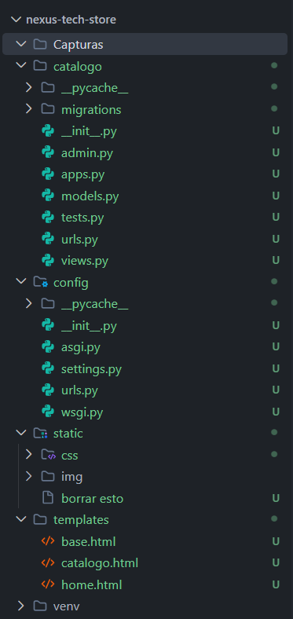
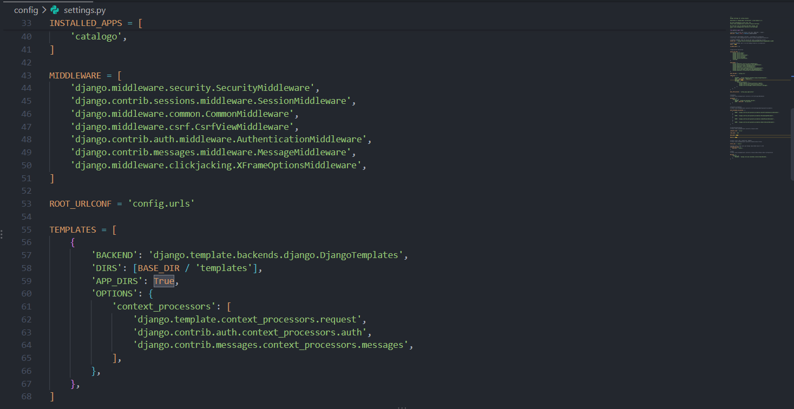
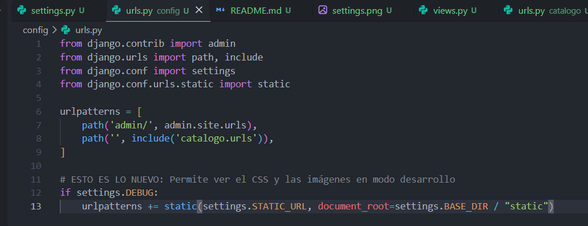
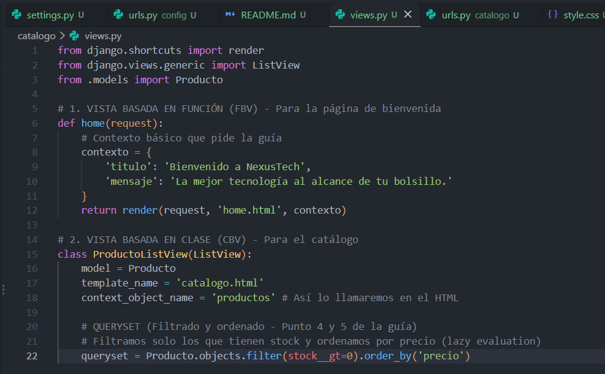
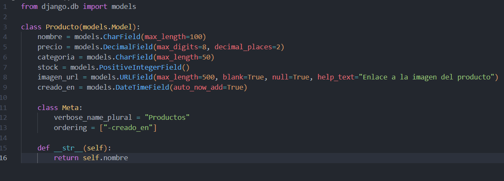
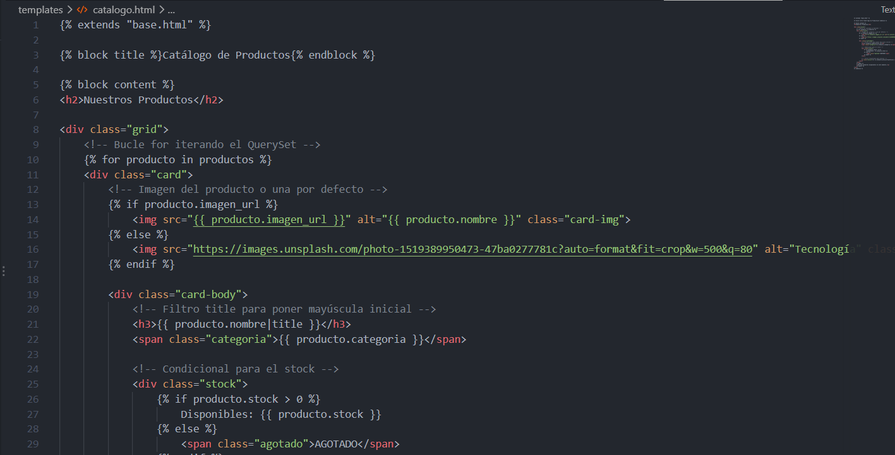
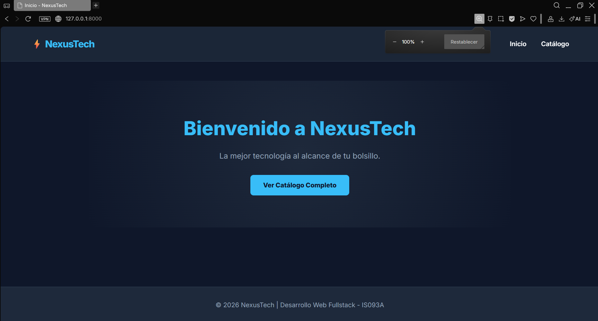
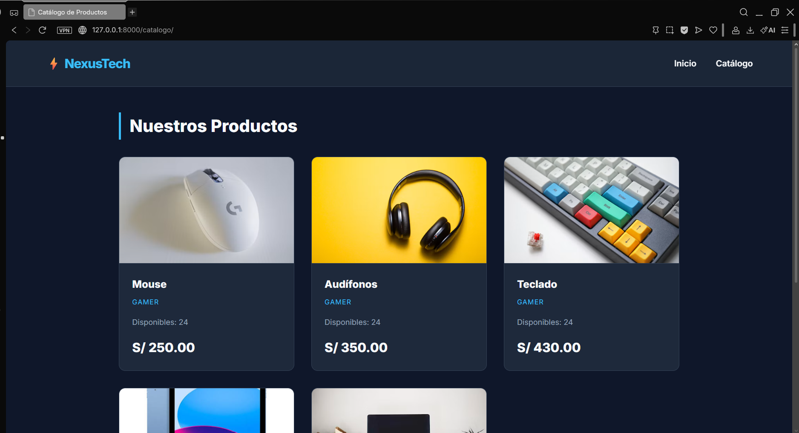
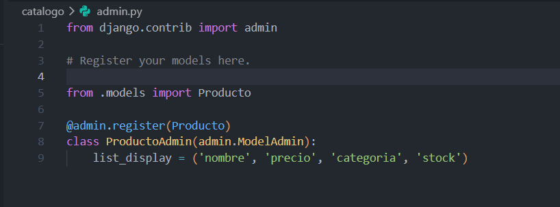

# NexusTech Store - Catálogo Tecnológico (Django MTV)

**Asignatura:** Desarrollo de Aplicaciones Web (IS093A)  
**Semana:** 11  
**Alumno:** Mauricio Paolo Vega Sanabria

##  Descripción del Proyecto
NexusTech Store es una aplicación web desarrollada con Django que implementa el patrón arquitectónico MTV (Model-Template-View). Consiste en un catálogo de productos tecnológicos con un diseño web moderno y responsivo (modo oscuro), que consume datos dinámicos desde una base de datos SQLite mediante el ORM de Django.

---

## 1. Configuración y Arquitectura MTV (20%)

### Estructura del Proyecto
El proyecto sigue la estructura estándar de Django, separando la configuración global (`config/`) de la lógica de la aplicación (`catalogo/`), e incluyendo carpetas para archivos estáticos y plantillas.

### Configuración de `settings.py`
Se registró la aplicación `catalogo` y se configuró la ruta global para las plantillas (`templates/`).

### URLs y Routing
Se utilizó `include()` para modularizar las rutas y `name=` para desacoplar las vistas de los enlaces en las plantillas.

---

## 2. Vistas: FBV y CBV (20%)

### Vista Basada en Función (FBV) - `home`
Se encarga de renderizar la página de bienvenida con un contexto básico.

### Vista Basada en Clase (CBV) - `ProductoListView`
Se utilizó una vista genérica `ListView` para el catálogo, inyectando automáticamente el `object_list` y aplicando un QuerySet filtrado.

---

## 3. Modelos y ORM (25%)

### Modelo `Producto`
Se definió la clase `Producto` con los campos requeridos (nombre, precio, categoría, stock, imagen_url), aplicando tipos de datos adecuados (como `DecimalField` y `PositiveIntegerField`).

### QuerySets y Lazy Evaluation
En la CBV se utilizó el siguiente QuerySet:
`Producto.objects.filter(stock__gt=0).order_by('precio')`

* **Lazy Evaluation (Evaluación diferida):** Los QuerySets en Django no realizan la consulta SQL a la base de datos inmediatamente al ser declarados. La consulta se "prepara" y solo se ejecuta cuando el template itera sobre los datos con el bucle ``. Esto ahorra recursos, ya que si el QuerySet no llega a usarse, la base de datos nunca recibe la petición.

---

## 4. Plantillas y Herencia (20%)

### Uso de Tags y Filtros en `catalogo.html`
Se implementó la herencia con ``. Además, se utilizaron etiquetas de control de flujo como `` y ``. También se aplicaron filtros como `|title` para capitalizar nombres y `|floatformat:2` para mostrar el precio con dos decimales.

### Renderizado Final del Catálogo
Vista del catálogo funcionando, aplicando los estilos CSS, las imágenes y el filtro de productos con stock mayor a cero.

---

## 5. Validación Técnica y Administración (15%)

### Panel de Administración
Se registró el modelo en `admin.py` para gestionar los productos de forma visual. Se comprobó que `python manage.py check` se ejecuta sin errores.

---

##  Instalación y Ejecución Local
1. Clonar el repositorio.
2. Crear y activar un entorno virtual: `python -m venv venv` y `venv\Scripts\activate` (Windows).
3. Instalar Django: `pip install django`.
4. Aplicar migraciones: `python manage.py migrate`.
5. Ejecutar el servidor: `python manage.py runserver`.
6. Abrir en el navegador: `http://127.0.0.1:8000/`.